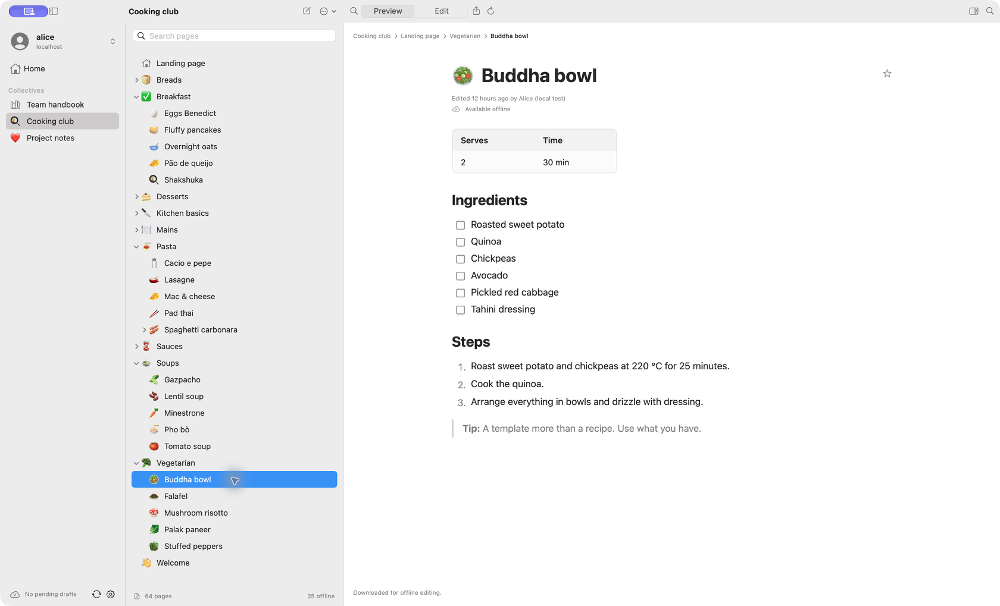

# Collectives

Your Nextcloud knowledge base on iPhone, iPad, and Mac. Browse shared handbooks,
project notes, or recipes, edit Markdown, and keep downloaded pages available offline.

Collectives is a native SwiftUI client for Nextcloud Collectives, where teams
organize knowledge into shared collections of linked pages. It connects to your
Nextcloud server and keeps your changes in sync.



*macOS development build with local sample content.*

## What you can do

- Read formatted pages and edit their Markdown source, or try experimental offline rich text.
- Browse nested pages, search downloaded content, and save favorites.
- Download pages for offline reading and editing, then sync when connected.
- Create and rename pages online.
- Use multiple Nextcloud accounts with separate offline content and credentials.
- Review conflicting edits before choosing which version to keep.

## Get started

**Early development:** this is not yet a release-ready app. For now, build it from
source using the steps below. Deployment targets are iOS/iPadOS 17+ and macOS 14+;
older-device compatibility still needs validation.

You need a Nextcloud account on a server with Collectives enabled.

1. Open the app and enter your Nextcloud server's HTTPS address.
2. Choose **Sign In with Browser** and approve access in Nextcloud.
3. Select a collective and open a page. Choose **Edit** to change its Markdown.
4. Before going offline, open the pages you need or choose **Download for Offline Editing**
   from the collective actions menu. Reconnect and use **Sync** to upload drafts.

Drafts are saved on your device and survive restarts. Automatic sync runs while
the app is open; conflicting server edits are retained for review. Account
credentials are stored in Keychain.

Collective downloads include page text, without attachments or image prefetching.
Offline page creation, moving or deleting pages, attachment management, background
sync, and live collaborative editing are not implemented yet.

See the [usage guide](docs/usage.md) for shortcuts, settings, and conflict handling.

## Development

For Mac development, install Swift 6+ through Xcode or Apple's Command Line Tools,
plus Python 3 and Node.js 22+ with npm/npx for the embedded Text assets. The first
app build fetches pinned dependencies; subsequent builds reuse cached assets.
From the repository root:

```sh
make run   # Build and open .build/Collectives.app
make test  # Run Swift tests
```

Quit an older running copy before `make run`. For iPhone or iPad, open
`Collectives.xcodeproj`, select the **Collectives** scheme, and choose a simulator
or device. Device builds need your development team in Signing & Capabilities.

To try sample content, install Docker Compose v2 and run `make server-up`.
Connect to `http://localhost:8080` and sign in as `alice` with `local-alice-only`.
These public credentials are only for the local test server.

See the [development guide](docs/development.md) for build options, signing,
tests, and project layout, or the [test server guide](dev/README.md) for fixtures
and server commands.

## AI usage

This app is developed with the help of AI coding agents. A human reviews and tests
every change before it is committed. Commits that had AI assistance carry an
`Assisted-by: AGENT:MODEL` trailer, so `git log` shows where it was used.

## License

[GNU AGPL v3](LICENSE). Dependency notices are in [ThirdParty](ThirdParty/).
